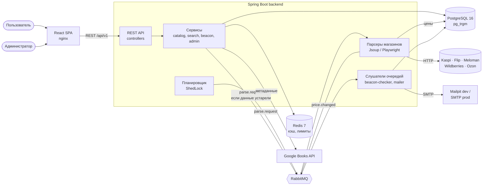

<p align="center">
  <picture>
    <source media="(prefers-color-scheme: dark)" srcset="docs/brand/logo-full-dark.svg">
    
  </picture>
</p>

<p align="center">Сравнение цен на книги в магазинах Казахстана и «маячки» на снижение цены</p>


# KitapRadar (Book Price Aggregator)

[](https://github.com/nurbolatdev/book-price-aggregator/actions/workflows/backend.yml)

Агрегатор цен на книги в магазинах Казахстана. Пользователь ищет книгу и видит цены всех магазинов на одном экране; можно поставить «маячок» и получить письмо, когда цена упадёт до нужного уровня. Для администратора есть панель: здоровье системы, парсеры, очереди, статистика.

Учебный проект, некоммерческий. Статус вех — [docs/README.md](docs/README.md).

## Скриншоты

Появятся после реализации нового интерфейса (frontend-вехи F1–F7).

## Архитектура

Модульный монолит на Spring Boot и фоновая обработка через RabbitMQ. Пользовательский запрос никогда не ждёт парсинга: API отвечает из PostgreSQL и Redis, а сеть, браузер и письма работают в фоне. Подробнее — [docs/01-architecture.md](docs/01-architecture.md).



Пакеты backend (по фичам):

```text
backend/src/main/java/kz/nurbolat/bookaggregator/
├── BookAggregatorApplication.java
├── common/
│   ├── error/               # GlobalExceptionHandler, ErrorCode, ErrorResponse, AppException
│   ├── text/                # TextNormalizer, IsbnUtils, Money, Hashing
│   └── web/                 # PageResponse, TraceIdFilter
├── config/                  # AppProperties, SecurityConfig, RedisConfig, OpenApiConfig, SchedulingConfig, TimeConfig
├── security/                # JwtService, JwtAuthFilter, ratelimit/ (Bucket4j)
├── user/                    # регистрация, вход, профиль, AdminBootstrap
├── auth/                    # email verification, refresh tokens, сброс пароля, очистка токенов
├── book/                    # Book, BookService, CatalogService, BookController
├── edition/                 # Edition, EditionService, история цен, EditionController
├── store/                   # Store, StoreCode, StoreController
├── offer/                   # Offer, PriceHistory, OfferIngestionService (upsert + событие)
├── search/                  # SearchService (pg_trgm), подсказки, SearchLogWriter, CatalogSeeder
├── home/                    # «подешевели»: DropsService, DropsRefreshJob, HomeController
├── metadata/                # GoogleBooksClient — только метаданные
├── parser/
│   ├── core/                # StoreParser, HtmlFetcher, BrowserFetcher, ParserRunService, StoreResilience
│   ├── matching/            # EditionMatcher: ISBN → похожесть названия/автора
│   ├── flip/                # FlipParser + селекторы
│   ├── meloman/             # MelomanParser + селекторы
│   └── ozon/                # OzonParser + селекторы
├── messaging/               # топология RabbitMQ, сообщения (message/), publisher-ы, listener-ы
├── scheduler/               # CrawlScheduler, CleanupScheduler, DigestScheduler, ManualRunService
├── beacon/                  # Beacon, BeaconChecker, BeaconService, BeaconController
├── notification/            # EmailSender, шаблоны, Notification, EmailListener
├── metrics/                 # KrMetrics (метрики kr.*)
├── dev/                     # DevDataLoader (демо-данные, профиль demo)
└── admin/                   # Admin*Controller, Admin*Service, SystemEvent, RabbitAdminClient
```

## Технологии

- Java 21, Spring Boot 3.3, Spring Security + JWT (access + refresh с ротацией)
- PostgreSQL 16 (pg_trgm) + Flyway, Redis 7 (кэш, лимиты запросов), RabbitMQ 3.13
- Jsoup и Playwright (Chromium) для парсеров, Resilience4j
- Frontend: React 18, TypeScript, Vite, Tailwind CSS, TanStack Query, Zustand, Vitest + Testing Library
- Тесты: JUnit 5, Mockito, Testcontainers, WireMock; покрытие — JaCoCo
- Нагрузка — k6; сборка и запуск — Docker Compose; CI — GitHub Actions

## Ключевые решения

- Парсеры живут внутри backend, а не отдельным сервисом — [ADR-002](docs/adr/ADR-002-parsers-in-backend.md).
- Фоновая работа и письма идут через очередь — [ADR-001](docs/adr/ADR-001-rabbitmq.md).
- Книга, издание и предложение магазина — отдельные сущности — [ADR-003](docs/adr/ADR-003-edition-model.md).
- Сессии через refresh-токены с ротацией — [ADR-004](docs/adr/ADR-004-refresh-token-sessions.md).
- Вежливый парсинг (robots.txt, низкая частота, без обхода защиты) — [docs/05-parsing-policy.md](docs/05-parsing-policy.md).

## Магазины

| Магазин | Статус | Как читается |
|---|---|---|
| Flip.kz | работает | HTTP + Jsoup, HTML и JSON-LD |
| Meloman | работает (поиск запрещён `robots.txt`: новые книги берутся из каталога) | HTTP + Jsoup, HTML и JSON-LD |
| Ozon | работает (поиск запрещён `robots.txt`: новые книги берутся из категории «Книги») | HTTP + Jsoup, JSON-LD и JSON в странице |
| Kaspi.kz | выключен: не отвечает парсеру, даже на `robots.txt` | — |
| Wildberries | выключен: отвечает антибот-проверкой с капчей | — |

Проверено 2026-10-22. Защита не обходится: выключенные магазины остаются выключенными, пока не начнут отвечать по правилам проекта. Подробности — [отчёт M15–M16](docs/backend/parsing-report-M15-M16.md).

## Запуск

Нужны Docker и Docker Compose.

```bash
git clone https://github.com/nurbolatdev/book-price-aggregator.git && cd book-price-aggregator
cp .env.example .env
docker compose up -d
```

Профиль `docker,demo` из `.env.example` при первом старте загружает демо-каталог (книги, издания, цены) и создаёт администратора. Чтобы начать с пустого каталога, уберите `,demo` из `SPRING_PROFILES_ACTIVE`.

| Что | Адрес |
|---|---|
| Frontend | http://localhost |
| API | http://localhost:8080/api/v1 |
| Swagger UI (группы `public`, `user`, `admin`) | http://localhost:8080/swagger-ui.html |
| RabbitMQ | http://localhost:15672 (guest / guest) |
| Mailpit (письма) | http://localhost:8025 |

Демо-администратор — `APP_ADMIN_EMAIL` и `APP_ADMIN_PASSWORD` из `.env`; **смените пароль перед тем, как открывать стенд наружу**.

Запуск парсера магазина вручную (парсинг при старте не выполняется):

```bash
TOKEN=$(curl -s localhost:8080/api/v1/auth/login -H 'Content-Type: application/json' \
  -d '{"email":"admin@example.com","password":"change_me_admin_password"}' | jq -r .accessToken)
curl -X POST localhost:8080/api/v1/admin/parsers/FLIP/run -H "Authorization: Bearer $TOKEN"
```

В демо-профиле за запуск обходится немного страниц (см. `application-demo.yml`).

## Разработка

```bash
docker compose up -d postgres redis rabbitmq mailpit
(cd backend && ./mvnw spring-boot:run)                  # терминал 1: backend с хоста
(cd frontend && npm ci && npm run dev)                  # терминал 2: frontend, http://localhost:5173 (/api проксируется на 8080)
```

Две последние команды запускаются в разных терминалах и друг от друга не зависят.

- Frontend (`cd frontend`): `npm run lint`, `npm test`, `npm run build`, `npm run gen:api` (перегенерировать `src/api/schema.d.ts` после изменения `docs/api/openapi.json`).
- Тесты: `cd backend && ./mvnw verify` (нужен Docker для Testcontainers). Отчёт покрытия — `backend/target/site/jacoco/index.html`; порог для сервисов — 70% строк.
- Нагрузочный тест k6 и результаты — [docs/performance.md](docs/performance.md).
- Контракт OpenAPI экспортирован в [docs/api/openapi.json](docs/api/openapi.json); после изменения аннотаций обновить: `cd backend && ./mvnw -B verify -Dit.test=OpenApiSpecIT -Dopenapi.update=true`.
- Описание REST API — [docs/03-api-contract.md](docs/03-api-contract.md) и Swagger UI.
- Правила кода и Git — [docs/04-conventions.md](docs/04-conventions.md).
