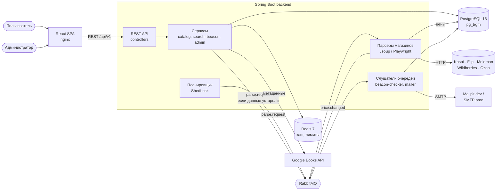
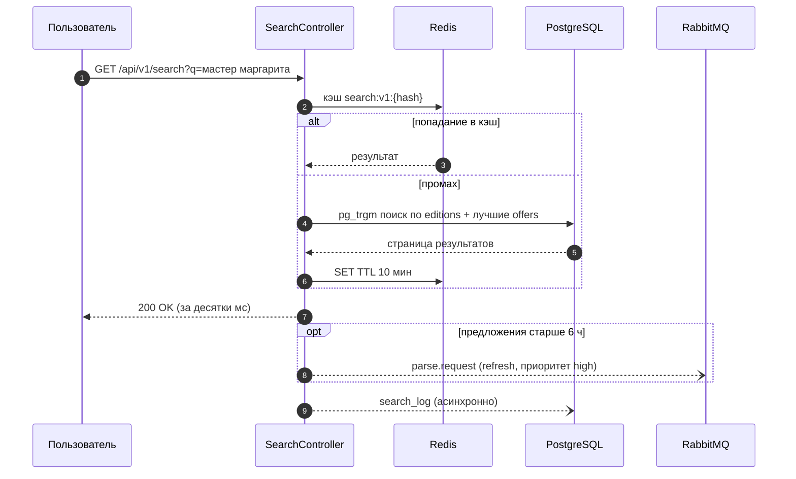
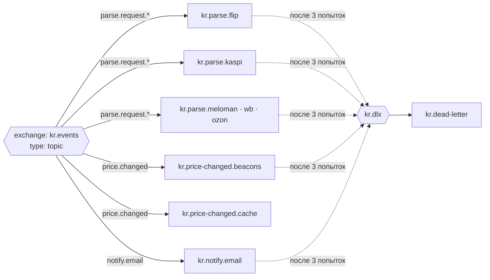

# 01. Архитектура

## 1. Общая схема

Модульный монолит на Spring Boot + фоновая обработка через RabbitMQ. Один deployable backend, внутри — чёткие модули по фичам.



**Главный принцип:** пользовательский запрос никогда не ждёт парсинга. API отвечает из PostgreSQL и Redis, а сеть, браузер и письма работают в фоне через очереди.

## 2. Поток «поиск»



## 3. Поток «цена изменилась → письмо»

```mermaid
sequenceDiagram
    autonumber
    participant S as Scheduler
    participant MQ as RabbitMQ
    participant P as Parser (Flip)
    participant DB as PostgreSQL
    participant B as BeaconChecker
    participant M as Mailer
    participant SMTP as SMTP/Mailpit

    S->>MQ: parse.request {store: FLIP, editionIds}
    MQ->>P: доставка (consumer магазина)
    P->>P: загрузка страниц, rate limit, circuit breaker
    P->>DB: upsert offer; price_history если цена изменилась
    P->>MQ: price.changed {offerId, old, new}
    MQ->>B: доставка
    B->>DB: активные маячки на это издание
    B->>B: проверка условия + защита от повторов
    B->>MQ: notify.email {beaconId, ...}
    MQ->>M: доставка
    M->>SMTP: письмо по шаблону Thymeleaf
    M->>DB: notification (SENT / FAILED)
    Note over MQ: 3 неудачи → dead-letter очередь → видно в админке
```

## 4. Топология RabbitMQ



| Очередь | Routing key | Кто читает | Параллельность |
|---|---|---|---|
| `kr.parse.<store>` | `parse.request.<store>` | парсер магазина | 1–2 consumer на магазин (вежливая скорость) |
| `kr.price-changed.beacons` | `price.changed` | `BeaconChecker` | 4 |
| `kr.price-changed.cache` | `price.changed` | сброс кэша Redis | 1 |
| `kr.notify.email` | `notify.email` | `EmailSender` | 2 |
| `kr.dead-letter` | — | только админка (просмотр, повтор) | — |

Правила: сообщения — JSON (Jackson), у каждого есть `messageId` (идемпотентность) и `occurredAt`. Повторы — 3 попытки с паузой (retry interceptor), потом DLQ. Подробнее — веха M17 и [ADR-001](adr/ADR-001-rabbitmq.md).

## 5. Кэш (Redis)

| Ключ | Что | TTL | Когда сбрасывается |
|---|---|---|---|
| `search:v1:{queryHash}:{filtersHash}:{page}` | страница поиска | 10 мин | по TTL |
| `edition:v1:{id}` | карточка издания с предложениями | 30 мин | событие `price.changed` для этого издания |
| `home:v1:drops-week` | «подешевели за неделю» | 15 мин | пересчёт планировщиком |
| `admin:v1:stats` | KPI админки | 1 мин | по TTL |
| `ratelimit:v1:{ip}:{route}` | лимит запросов (Bucket4j) | окно лимита | — |
| `parser:v1:html:{urlHash}` | сырой HTML страницы магазина | 1 ч | по TTL (меньше запросов к магазинам) |

Префикс версии `v1` в каждом ключе — при смене формата меняем на `v2`, старые ключи просто истекут.

## 6. Структура пакетов (цель после Фазы 2)

```text
backend/src/main/java/kz/nurbolat/bookaggregator/
├── BookAggregatorApplication.java
├── common/                  # общее: ApiError, исключения, PageResponse, утилиты текста
│   ├── error/               #   GlobalExceptionHandler, ErrorCode, ApiError
│   └── text/                #   TextNormalizer (нормализация названий для поиска)
├── config/                  # Spring-конфиги: Async, Redis, RabbitMQ, OpenAPI, Web, Clock
├── security/                # JWT, фильтр, SecurityConfig, rate limit (Bucket4j)
├── user/                    # пользователь, регистрация, вход, профиль
├── auth/                    # email verification, refresh tokens, сброс пароля
├── book/                    # книга (произведение) — Book, BookRepository
├── edition/                 # издание: Edition, EditionService, EditionController
├── store/                   # справочник магазинов: Store, StoreCode (enum)
├── offer/                   # Offer, PriceHistory, OfferIngestionService (upsert + событие)
├── search/                  # SearchService (pg_trgm), фильтры, подсказки, SearchLog
├── metadata/                # GoogleBooksClient — только метаданные
├── parser/
│   ├── core/                # StoreParser, ParsedOffer, HtmlFetcher, ParserRunService
│   ├── matching/            # EditionMatcher: ISBN → похожесть названия/автора
│   ├── flip/                # FlipParser + селекторы
│   ├── kaspi/
│   ├── meloman/
│   ├── wildberries/
│   └── ozon/
├── messaging/               # топология RabbitMQ, сообщения (record), publisher-ы, listener-ы
├── scheduler/               # расписания: обход магазинов, пересчёт «подешевели», чистка
├── beacon/                  # маячки: Beacon, условия, BeaconChecker, BeaconController
├── notification/            # EmailSender, шаблоны, Notification, unsubscribe
└── admin/                   # AdminStatsService, AdminController, SystemEvent
```

Внутри фичи: `Entity`, `Repository`, `Service`, `Controller`, подпапка `dto/`. Контроллер не ходит в репозиторий напрямую — только через сервис. Фича может использовать сервис другой фичи, но не её репозиторий.

## 7. Нефункциональные требования
| Требование | Цель |
|---|---|
| Поиск (тёплый кэш) | p95 < 200 мс |
| Поиск (холодный) | p95 < 500 мс |
| Карточка издания | p95 < 300 мс |
| Нагрузка на магазин | ≤ 1 запрос в 2 с на магазин (настраивается) |
| Падение одного магазина | не влияет на остальные (circuit breaker) |
| Потеря сообщений | нет: durable очереди, persistent сообщения, manual ack |
| Безопасность | роли USER/ADMIN, BCrypt, JWT 15 мин + refresh 30 дней, лимиты на auth и поиск |
