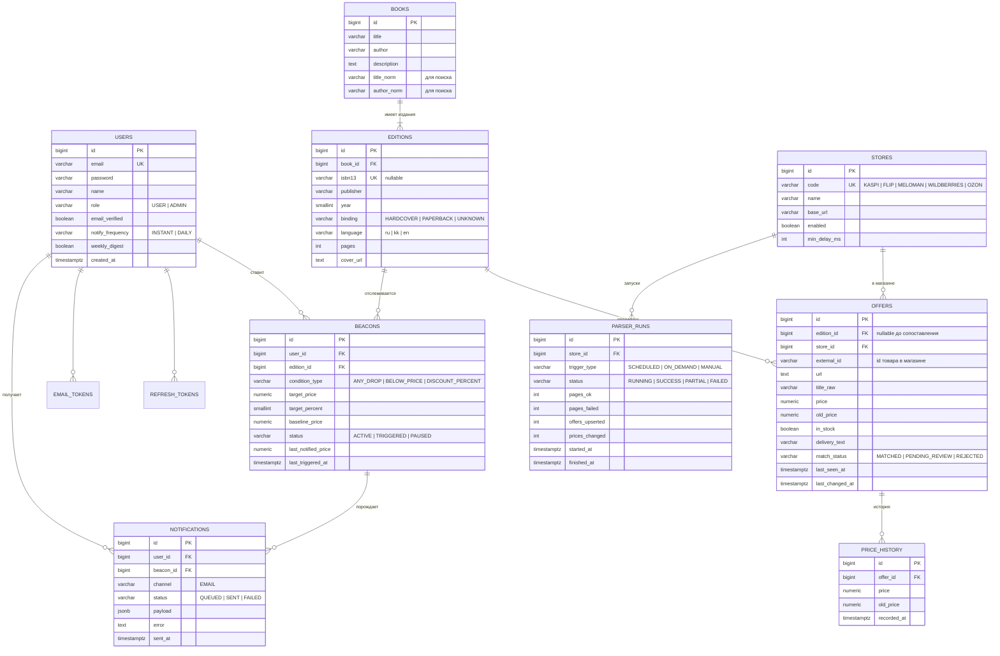

# 02. Модель данных

PostgreSQL 16. Все изменения — миграции Flyway в `backend/src/main/resources/db/migration`. Существующие V1–V3 не редактируются; новые начинаются с **V4**.

## 1. ER-диаграмма (цель после M13)



Не на диаграмме (служебные): `email_tokens`, `refresh_tokens`, `search_log`, `system_events`, `shedlock`, `favorites` (устаревшая, удаляется в F3).

## 2. Таблицы подробно

### users (изменение)
Добавить: `email_verified BOOLEAN NOT NULL DEFAULT FALSE`, `notify_frequency VARCHAR(20) NOT NULL DEFAULT 'INSTANT'`, `weekly_digest BOOLEAN NOT NULL DEFAULT TRUE`, `updated_at`. Существующим пользователям выставить `email_verified = TRUE` (чтобы не сломать вход).

### books (изменение)
Остаётся как «произведение». Поля `isbn`, `publisher`, `published_at`, `cover_url` **переезжают в editions** (миграция данных: на каждую книгу создаётся одно издание). Добавить `title_norm`, `author_norm` — нормализованные строки (нижний регистр, `ё→е`, без пунктуации) для поиска.

### editions (новая)
| Колонка | Тип | Примечание |
|---|---|---|
| id | BIGSERIAL PK | |
| book_id | BIGINT FK → books ON DELETE CASCADE | |
| isbn13 | VARCHAR(13) UNIQUE NULL | только цифры, ISBN-10 конвертировать в 13 |
| publisher | VARCHAR(255) | |
| year | SMALLINT | |
| binding | VARCHAR(20) NOT NULL DEFAULT 'UNKNOWN' | |
| language | VARCHAR(5) | `ru`, `kk`, `en` |
| pages | INT | |
| cover_url | TEXT | |
| created_at, updated_at | TIMESTAMPTZ | |

### stores (новая, справочник)
Заполняется миграцией: KASPI, FLIP, MELOMAN, WILDBERRIES, OZON. `enabled` позволяет выключить магазин без деплоя. `min_delay_ms` — пауза между запросами (по умолчанию 2000).

### offers (переделка)
- `book_id` → `edition_id` (NULL допустим, пока не сопоставлено), `source VARCHAR` → `store_id FK`.
- Добавить: `external_id`, `title_raw`, `old_price` (переименовать `original_price`), `delivery_text`, `match_status`, `first_seen_at`, `last_seen_at`, `last_changed_at`.
- `UNIQUE (store_id, external_id)` — основа upsert.
- Индексы: `(edition_id)`, `(edition_id, price) WHERE in_stock`, `(match_status) WHERE match_status = 'PENDING_REVIEW'`.
- Старые моковые предложения (`kaspi`, `ozon`, `google_books`) удаляются миграцией — это фейковые данные.

### price_history (изменение)
Добавить `old_price`. Правило: **запись создаётся только при изменении цены** (сервис сравнивает с текущей ценой offer). Индекс `(offer_id, recorded_at DESC)`.

### beacons (новая, заменяет price_alerts)
- `UNIQUE (user_id, edition_id)`.
- Проверки (CHECK): `BELOW_PRICE` требует `target_price`, `DISCOUNT_PERCENT` требует `target_percent` 1–90.
- `baseline_price` — лучшая цена в момент создания (для `ANY_DROP` и `DISCOUNT_PERCENT`).
- `last_notified_price` — защита от повторных писем на ту же цену.
- Индекс `(edition_id) WHERE status = 'ACTIVE'`.
- Миграция данных: `price_alerts` → `beacons` (BELOW_PRICE, издание = единственное издание книги), затем `DROP TABLE price_alerts`.

### notifications (новая)
История писем: что, кому, статус, ошибка. `payload JSONB` — данные письма (цены, магазин). Индекс `(user_id, created_at DESC)`, `(status)`.

### email_tokens (новая)
`id, user_id FK, token_hash VARCHAR(64) UNIQUE, purpose VARCHAR(20) ('VERIFY_EMAIL' | 'RESET_PASSWORD' | 'UNSUBSCRIBE'), expires_at, used_at`. В БД хранится **SHA-256 хеш** токена, сам токен — только в письме.

### refresh_tokens (новая)
`id, user_id FK, family_id UUID, token_hash UNIQUE, expires_at, revoked_at, created_at, user_agent`. Ротация: при обновлении старый помечается revoked, новый получает тот же `family_id` (одно семейство = один вход на одном устройстве). Повтор отозванного токена отзывает его семейство. Записи удаляются ночной очисткой через 30 дней после `expires_at`, `email_tokens` — через 7 дней.

### parser_runs (новая)
Каждый проход парсера. Используется админкой и для расчёта «% успешных страниц». Индекс `(store_id, started_at DESC)`.

### search_log (новая)
`id, query VARCHAR(300), query_norm, results_count INT, user_id NULL, created_at`. Пишется асинхронно. Индекс `(created_at)`. Чистка старше 90 дней — планировщиком.

### system_events (новая)
`id, level VARCHAR(10) ('INFO'|'WARN'|'ERROR'), source VARCHAR(50), message TEXT, details JSONB, created_at`. Журнал для админки (не замена логам).

### shedlock (новая)
Стандартная таблица ShedLock: `name PK, lock_until, locked_at, locked_by`.

## 3. Поиск: индексы pg_trgm
```sql
CREATE EXTENSION IF NOT EXISTS pg_trgm;
CREATE INDEX idx_books_title_trgm  ON books USING GIN (title_norm gin_trgm_ops);
CREATE INDEX idx_books_author_trgm ON books USING GIN (author_norm gin_trgm_ops);
```
Запрос: `WHERE title_norm % :q OR author_norm % :q OR title_norm ILIKE '%' || :q || '%'`, сортировка по `GREATEST(similarity(title_norm, :q), similarity(author_norm, :q)) DESC`. Порог `pg_trgm.similarity_threshold` = 0.3 (настраивается). Поиск по ISBN — отдельная ветка: если запрос похож на ISBN, ищем точно по `editions.isbn13`.

## 4. План миграций
| Миграция | Веха | Содержание |
|---|---|---|
| V4__stores.sql | M13 | `stores` + seed 5 магазинов |
| V5__editions.sql | M13 | `editions`, перенос данных из `books`, нормализованные поля |
| V6__offers_v2.sql | M13 | переделка `offers`, удаление моков, `price_history.old_price` |
| V7__beacons.sql | M13 | `beacons`, перенос из `price_alerts`, drop `price_alerts` |
| V8__search_trgm.sql | M14 | `pg_trgm`, GIN-индексы, `search_log` |
| V9__parser_runs.sql | M15 | `parser_runs`, `system_events` |
| V10__disable_kaspi.sql | M16 | Kaspi выключен (не отвечает парсеру) |
| V11__disable_wildberries.sql | M16 | Wildberries выключен (антибот-проверка) |
| V12__shedlock.sql | M17 | `shedlock` |
| V13__auth_v2.sql | M18 | поля `users`, `email_tokens`, `refresh_tokens` |
| V14__refresh_token_families.sql | M18 | `refresh_tokens.family_id` |
| V15__auth_token_expiry_indexes.sql | M18 | индексы `expires_at` для очистки токенов |
| V16__notifications.sql | M19 | `notifications` |

Номера могут сдвинуться, если понадобится промежуточная миграция — главное, по порядку и без правки старых.
