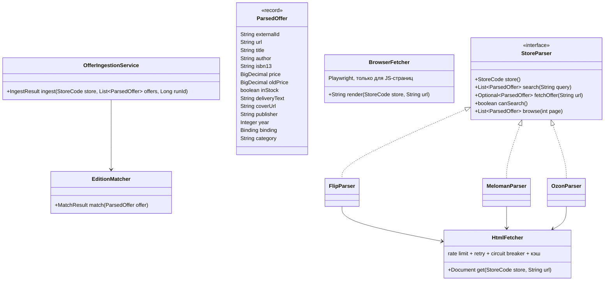

# 05. Парсинг магазинов: правила и устройство

## 1. Правила (обязательные)
Проект учебный, поэтому парсим **вежливо и открыто**:

1. **Только публичные страницы**, доступные без входа в аккаунт. Никаких логинов, личных кабинетов, платных API без ключа.
2. **Уважать `robots.txt`.** Перед первым запуском магазина проверить его `robots.txt`; запрещённые пути не парсить. Результат проверки записать в комментарий к классу парсера.
3. **Низкая частота:** не чаще 1 запроса в `stores.min_delay_ms` (по умолчанию 2000 мс) на магазин, 1–2 параллельных потока на магазин, кэш HTML на 1 час.
4. **Честный User-Agent:** `KitapRadarBot/1.0 (+https://github.com/nurbolatdev/book-price-aggregator; educational project)` (настройка `app.parser.user-agent`). Заголовки HTTP допускают только ASCII, поэтому пометка «учебный проект» записана по-английски.
5. **Не обходить защиту.** Запрещено: решение/обход капчи, подмена отпечатков браузера (stealth-плагины), ротация прокси или IP для обхода блокировок, подделка cookie сессий. Если магазин отвечает 403/429/капчей — парсер **останавливается** (circuit breaker), запуск помечается `FAILED`, в `system_events` пишется WARN, магазин можно выключить в админке. Это нормальный, ожидаемый результат, а не повод для обходных путей.
6. **Хранить только нужное:** название, автор, ISBN, цена, старая цена, наличие, доставка (текст), ссылка, обложка (ссылкой, не копией файла).
7. В интерфейсе всегда показывать время обновления и ссылку на страницу магазина.

> Если какой-то магазин недоступен по этим правилам, проект всё равно засчитывается: в README честно указываем, какие магазины работают, а архитектура показывает, как подключить новый.

## 2. Устройство

- **`StoreParser`** — только извлечение данных из страниц. Ничего не пишет в БД. Если `robots.txt` магазина запрещает поиск, `canSearch()` возвращает `false`, и новые предложения ищутся не поиском, а по первым страницам каталога книг (`browse(page)`, лимит `app.parser.max-browse-pages-per-run`, по умолчанию 5): берутся товары, чьё очищенное название совпадает с названием разыскиваемого издания.
- **`HtmlFetcher`** — единая точка сетевых запросов: Jsoup, таймаут 10 с, Resilience4j `RateLimiter` + `Retry` (2 повтора на 5xx/таймаут, **без повтора на 403/429**) + `CircuitBreaker` (открывается после 50% ошибок на 10 вызовах, пауза 30 мин). Кэш HTML в Redis на 1 час.
- **`BrowserFetcher`** — Playwright Chromium (headless), один общий браузер, контекст на запрос, блокировка картинок/шрифтов/медиа. Используется, только если страница без JS пустая. Те же лимиты: общий с `HtmlFetcher` rate limiter и circuit breaker магазина (`StoreResilience`), кэш (ключ с префиксом `rendered:`). Включается флагом `app.parser.browser.enabled` (`PARSER_BROWSER_ENABLED`); в образе backend браузер установлен. Сейчас ни один работающий магазин его не требует.
- **Капча:** страница считается проверкой, если на ней виджет капчи (`data-sitekey`, `data-site-key`, `.g-recaptcha`, `.h-captcha`, `.smart-captcha`, `.cf-turnstile`) или форма с капчей внутри. Одного слова «captcha» мало: Magento пишет настройки капчи входа в каждую страницу.
- **Предпочтение источников внутри магазина:** (1) JSON-LD / microdata на странице товара (`schema.org/Product`, `Book`) — самый стабильный вариант; (2) обычный HTML через CSS-селекторы; (3) Playwright. Селекторы — константы в одном классе `<Store>Selectors`.
- **`OfferIngestionService`** — единственное место записи предложений: upsert по `(store_id, external_id)`, сопоставление с изданием, запись `price_history` только при изменении цены, публикация события `price.changed`.

## 3. Сопоставление предложения с изданием (`EditionMatcher`)
Порядок:
1. **Не-книги** (обложки, закладки, открытки, ежедневники, блокноты, складные карты; категории «канцтовары», «сувениры», «аксессуары» и т.п.) → `REJECTED` (`NonBookFilter`).
2. **Название очищается** (`TitleCleaner`): убираются переплёт, «подарочное издание», серии («эксклюзивная классика»), «с иллюстрациями …», «Комплект из 2 книг», «(в 2-х томах)», язык издания в скобках, ведущее «Книга:», артикулы, кавычки. Переплёт и год из названия дополняют данные страницы.
3. **ISBN** найден → `editions.isbn13`. Нашли — `MATCHED`. Не нашли — новое издание: к книге, которая явно то же произведение (пороги ниже), иначе новая книга; метаданные — Google Books по ISBN, иначе со страницы магазина.
4. **Нет ISBN** → кандидаты через pg_trgm: 5 книг с самым похожим названием (`similarity`, оператор `%`). Сходство считается в Java тем же способом, что и в pg_trgm (`TrigramSimilarity`):
   - названия ≥ 0.85 **и** автора ≥ 0.7, одна книга и одно подходящее издание (издательство и год сравниваются, только если известны обеим сторонам) → `MATCHED`;
   - иначе, если название ≥ 0.6 или автор неизвестен → `PENDING_REVIEW` (админка: `GET /api/v1/admin/offers/pending-review`, `POST …/{id}/match`, `POST …/{id}/reject`);
   - иначе (название не похоже ни на одну книгу, автор известен) → новая книга и издание.
   - Сходство авторов: целиком или по словам без инициалов, что выше — «Булгаков М. А.», «Булгаков Михаил Афанасьевич» и «Михаил Булгаков» совпадают.

Пороги — `app.parser.matching.*` (`title-threshold` 0.85, `author-threshold` 0.7, `review-threshold` 0.6, `candidates` 5).
Проверены на 40 реальных названиях Flip, Meloman и Ozon (`src/test/resources/matching/cases.csv`, `MatchingAccuracyTest`): 39 решений верны (97.5%). Единственная ошибка — карточка без автора уходит на ручную проверку вместо сопоставления. Правила очистки подбирались на этом же наборе, отдельной контрольной выборки нет.

## 4. Тесты парсеров
- Для каждого магазина в `src/test/resources/fixtures/<store>/` лежат 3–5 сохранённых страниц: обычная карточка, со скидкой, нет в наличии, страница поиска, страница без ISBN.
- Сохранять страницы вручную через браузер («Сохранить как HTML») один раз; тесты работают офлайн.
- Тест проверяет все поля `ParsedOffer`. Если магазин поменял вёрстку — падает тест, обновляем фикстуры и селекторы.

## 5. Магазины: заметки
Проверено 2026-10-22 с User-Agent парсера.

| Магазин | Что на сайте | Как парсим | Статус |
|---|---|---|---|
| Flip.kz | серверный HTML, защиты нет. `robots.txt` содержит правила только для Yandex и Bingbot; парсер всё равно запрашивает лишь то, что разрешено и им: первую страницу поиска `/search?search=…` (без `page`/`filter`/`order`) и карточки `/catalog?prod=ID`. В выдаче: цена, старая цена, наличие (`data-available`), название, переплёт и год, издательство, доставка — без автора и ISBN. В карточке: JSON-LD `schema.org/Product` (цена, наличие, картинка) и таблица характеристик (ISBN — иногда несколько через запятую, издательство, переплёт, год); автор — ссылки под заголовком. Цены — целые ₸ с узким неразрывным пробелом | Jsoup: поиск → карточка товара | ✅ M15 |
| Meloman (meloman.kz, тот же каталог, что у marwin.kz) | Magento, серверный HTML. `robots.txt` запрещает всем роботам `/catalogsearch/` — поиск не используется; автодополнение строки поиска без сессии браузера отвечает пустым списком. Разрешены каталог `/books/?p=N` (50 товаров на странице, только в наличии; страница весит 5–6 МБ) и карточки. В каталоге: «Автор И.: Название», цена, категория. В карточке: JSON-LD `Book` или `Product` и таблица характеристик (автор, ISBN, издательство, год, переплёт). Цена — из блока цены (`data-price-type="finalPrice"`): в JSON-LD бывает цена по карте лояльности, ниже той, что платит посетитель | Jsoup: каталог → карточка | ✅ M16 |
| Kaspi.kz | соединение устанавливается, но ответа нет ни на одну страницу, включая `robots.txt` (`Empty reply from server`); в браузере — 502. Недоступный `robots.txt` по RFC 9309 значит «запрещено всё» | парсера нет: не с чего снять фикстуры | ⛔ выключен (V10) |
| Wildberries | любая страница, включая `robots.txt`, отвечает антибот-проверкой (HTTP 498, `__wbaas/challenges/antibot`, ключ капчи); headless-браузер токен не получает; JSON-API каталога (`search.wb.ru`) недоступен | парсера нет: обходить проверку нельзя | ⛔ выключен (V11) |
| Ozon (ozon.kz) | страницы рендерятся на сервере вместе с данными, антибот пропускает парсер (обычный HTTP, без браузера). `robots.txt` запрещает всем `/search`; явно разрешены страницы категорий `?page=N` и карточки. Данные — в JSON-LD (цена, наличие, издательство как `brand`) и в JSON-состоянии виджетов: `webPrice` (цена, зачёркнутая цена, `isAvailable`), `webProductHeading` («Название \| Авторы»), `webCharacteristics` (ISBN, год, обложка). У части карточек характеристики грузятся позже скриптом — тогда ISBN нет. Порядок товаров в категории меняется от запроса к запросу, поэтому поиск новых по каталогу находит книгу, только если она в этот момент на первых страницах | Jsoup: категория «Книги» → карточка | ✅ M16 |

Выключенный магазин можно включить обратно (`UPDATE stores SET enabled = true …`, в M20 — через админку), когда он станет отвечать парсеру по этим правилам.

Перед реализацией каждого магазина: открыть сайт, проверить `robots.txt`, понять, где на странице цена/ISBN/наличие, сохранить фикстуры. Таблицу выше обновить фактическими данными.
