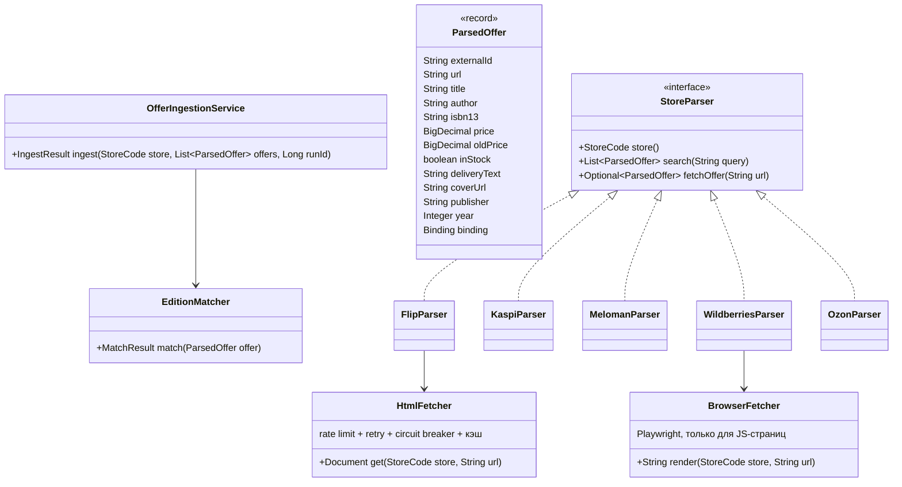

# 05. Парсинг магазинов: правила и устройство

## 1. Правила (обязательные)
Проект учебный, поэтому парсим **вежливо и открыто**:

1. **Только публичные страницы**, доступные без входа в аккаунт. Никаких логинов, личных кабинетов, платных API без ключа.
2. **Уважать `robots.txt`.** Перед первым запуском магазина проверить его `robots.txt`; запрещённые пути не парсить. Результат проверки записать в комментарий к классу парсера.
3. **Низкая частота:** не чаще 1 запроса в `stores.min_delay_ms` (по умолчанию 2000 мс) на магазин, 1–2 параллельных потока на магазин, кэш HTML на 1 час.
4. **Честный User-Agent:** `KitapRadarBot/1.0 (+https://github.com/nurbolatdev/book-price-aggregator; учебный проект)`.
5. **Не обходить защиту.** Запрещено: решение/обход капчи, подмена отпечатков браузера (stealth-плагины), ротация прокси или IP для обхода блокировок, подделка cookie сессий. Если магазин отвечает 403/429/капчей — парсер **останавливается** (circuit breaker), запуск помечается `FAILED`, в `system_events` пишется WARN, магазин можно выключить в админке. Это нормальный, ожидаемый результат, а не повод для обходных путей.
6. **Хранить только нужное:** название, автор, ISBN, цена, старая цена, наличие, доставка (текст), ссылка, обложка (ссылкой, не копией файла).
7. В интерфейсе всегда показывать время обновления и ссылку на страницу магазина.

> Если какой-то магазин недоступен по этим правилам, проект всё равно засчитывается: в README честно указываем, какие магазины работают, а архитектура показывает, как подключить новый.

## 2. Устройство

- **`StoreParser`** — только извлечение данных из страниц. Ничего не пишет в БД.
- **`HtmlFetcher`** — единая точка сетевых запросов: Jsoup, таймаут 10 с, Resilience4j `RateLimiter` + `Retry` (2 повтора на 5xx/таймаут, **без повтора на 403/429**) + `CircuitBreaker` (открывается после 50% ошибок на 10 вызовах, пауза 30 мин). Кэш HTML в Redis на 1 час.
- **`BrowserFetcher`** — Playwright Chromium (headless), один общий браузер, контекст на запрос, блокировка картинок/шрифтов для скорости. Используется, только если страница без JS пустая. Те же лимиты.
- **Предпочтение источников внутри магазина:** (1) JSON-LD / microdata на странице товара (`schema.org/Product`, `Book`) — самый стабильный вариант; (2) обычный HTML через CSS-селекторы; (3) Playwright. Селекторы — константы в одном классе `<Store>Selectors`.
- **`OfferIngestionService`** — единственное место записи предложений: upsert по `(store_id, external_id)`, сопоставление с изданием, запись `price_history` только при изменении цены, публикация события `price.changed`.

## 3. Сопоставление предложения с изданием (`EditionMatcher`)
Порядок:
1. **ISBN** найден на странице → ищем `editions.isbn13`. Нашли — `MATCHED`. Не нашли — запрашиваем метаданные в Google Books по ISBN и создаём книгу + издание.
2. **Нет ISBN** → нормализуем название и автора (`TextNormalizer`: нижний регистр, `ё→е`, убрать кавычки, скобки с «подарочное издание», лишние пробелы) и ищем кандидатов через pg_trgm:
   - сходство названия ≥ 0.85 **и** автора ≥ 0.7 и издательство совпадает (если известно) → `MATCHED`;
   - сходство 0.6–0.85 → `PENDING_REVIEW` (видно в админке, можно привязать вручную);
   - ниже → создаём новую книгу/издание, если на странице достаточно данных (название + автор), иначе `PENDING_REVIEW`.
3. Не-книги (обложки, закладки, наборы) отсекаются по категории магазина и по стоп-словам в названии → `REJECTED`.

Пороги — в `app.parser.matching.*`, подбираются на тестовых данных в M16.

## 4. Тесты парсеров
- Для каждого магазина в `src/test/resources/fixtures/<store>/` лежат 3–5 сохранённых страниц: обычная карточка, со скидкой, нет в наличии, страница поиска, страница без ISBN.
- Сохранять страницы вручную через браузер («Сохранить как HTML») один раз; тесты работают офлайн.
- Тест проверяет все поля `ParsedOffer`. Если магазин поменял вёрстку — падает тест, обновляем фикстуры и селекторы.

## 5. Магазины: заметки
| Магазин | Ожидание | Вероятный способ | Порядок |
|---|---|---|---|
| Flip.kz | серверный HTML | Jsoup | первый (M15) |
| Meloman / Marwin | серверный HTML | Jsoup | M16 |
| Kaspi.kz | часть данных рендерится JS, возможна защита | JSON-LD → Jsoup → Playwright | M16 |
| Wildberries | SPA | Playwright или публичные JSON-ответы, которые запрашивает сама страница каталога | M16 |
| Ozon | SPA, активная антибот-защита | Playwright; если блокирует — магазин `enabled=false`, честно в README | M16 |

Перед реализацией каждого магазина: открыть сайт, проверить `robots.txt`, понять, где на странице цена/ISBN/наличие, сохранить фикстуры. Таблицу выше обновить фактическими данными.
