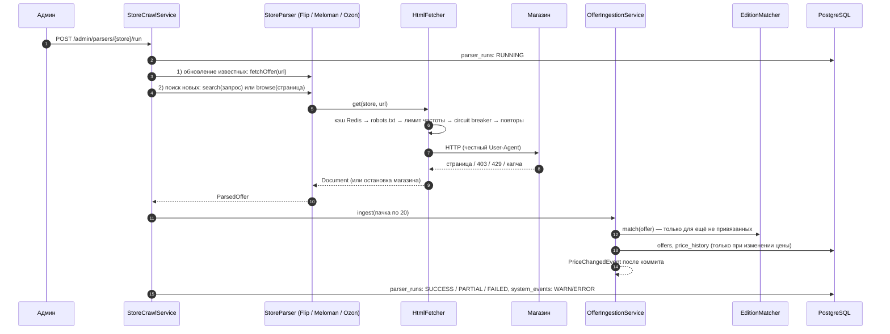

# Парсинг магазинов: итоги вех M15–M16

Отчёт о том, что сделано в вехах M15 (каркас парсеров и Flip.kz) и M16 (остальные магазины и сопоставление
изданий): как устроен сбор цен, какие магазины работают и почему остальные нет, что проверено и как, что
осталось. Правила парсинга — [05-parsing-policy.md](../05-parsing-policy.md), задания вех —
[M15](M15-parser-framework.md) и [M16](M16-store-parsers.md).

Состояние на 2026-10-22.

## 1. Коротко

- В системе настоящие цены из **трёх магазинов из пяти**: Flip.kz, Meloman, Ozon.
- **Kaspi.kz и Wildberries выключены**: Kaspi не отвечает парсеру, Wildberries отвечает антибот-проверкой
  с капчей. По правилам проекта защита не обходится.
- Одна и та же книга из разных магазинов сводится к одному изданию (по ISBN или по похожим названию и автору),
  сомнительные случаи уходят администратору на ручную проверку.
- Запуск парсера пока ручной и синхронный (`POST /api/v1/admin/parsers/{store}/run`); очереди и расписание —
  веха M17.

| Магазин | Статус | Как читается | Как находятся новые книги |
|---|---|---|---|
| Flip.kz | ✅ работает (M15) | HTML + JSON-LD, Jsoup | поиск по ISBN или «название автор» |
| Meloman | ✅ работает (M16) | HTML (Magento) + JSON-LD, Jsoup | первые страницы каталога «Книги» (поиск запрещён `robots.txt`) |
| Ozon | ✅ работает (M16) | JSON-LD + JSON-состояние виджетов, Jsoup | первые страницы категории «Книги» (поиск запрещён `robots.txt`) |
| Kaspi.kz | ⛔ выключен (V10) | — | — |
| Wildberries | ⛔ выключен (V11) | — | — |

## 2. Что сделано

### M15 — каркас парсеров и Flip.kz (PR #18, смерджен)

- Зависимости: Jsoup, Resilience4j (+ AOP), WireMock для тестов.
- Миграция `V9__parser_runs.sql`: таблицы `parser_runs` (каждый запуск со статистикой) и `system_events`
  (журнал событий для админки).
- Ядро `parser/core/`: интерфейс `StoreParser`, запись `ParsedOffer`, настройки `ParserProperties`
  (`app.parser.*`), загрузчик страниц `HtmlFetcher`, проверка `robots.txt` (`RobotsTxtChecker`), учёт
  запусков (`ParserRunService`), обход магазина (`StoreCrawlService`).
- Запись предложений `OfferIngestionService`: upsert по `(store_id, external_id)`, история цены только при
  изменении, событие `PriceChangedEvent` после коммита, пометка давно не встреченных предложений как
  отсутствующих.
- Сопоставление v1 `EditionMatcher`: по ISBN или по точному совпадению названия и автора.
- Парсер Flip.kz с фикстурами; ручной запуск `POST /api/v1/admin/parsers/{storeCode}/run` (роль ADMIN).
- Демо-предложения из сид-данных переведены на домен `.example`, а обновление известных предложений берёт
  только адреса с сайта самого магазина — парсер не ходит по несуществующим страницам.

### M16 — остальные магазины и сопоставление изданий

| Коммит | Что внутри |
|---|---|
| `docs: mark m15 as done` | статус M15 в `docs/README.md` |
| `feat: fuzzy edition matching with title cleaner and non-book filter` | `EditionMatcher` v2, `TitleCleaner`, `NonBookFilter`, `TrigramSimilarity`, поиск кандидатов через pg_trgm, `MatchingProperties`, `EditionMatcherIT` |
| `test: matching accuracy dataset` | 40 реальных пар «название в магазине → издание», `MatchingAccuracyTest` |
| `feat: playwright browser fetcher behind feature flag` | `BrowserFetcher` (Playwright Chromium), общие лимиты магазина `StoreResilience`, флаг `app.parser.browser.enabled`, `BrowserFetcherIT` (`-Pbrowser`) |
| `build: install playwright chromium in backend image` | образ backend на Ubuntu-JRE с Chromium; `PARSER_BROWSER_ENABLED`, `shm_size` в compose |
| `feat: meloman parser with fixtures` | парсер Meloman; поиск новых книг по каталогу для магазинов без поиска (`canSearch`/`browse`); общие функции разбора `PageValues`; точнее распознавание капчи; лимит страницы 8 МБ |
| `chore: disable kaspi, which does not answer the parser` | `V10__disable_kaspi.sql` |
| `chore: disable wildberries, which answers with an antibot challenge` | `V11__disable_wildberries.sql` |
| `feat: ozon parser with fixtures` | парсер Ozon |
| `feat: admin review of unmatched offers` | `OfferReviewService`, `GET/POST /api/v1/admin/offers/...` |
| `docs: update store notes and milestone status` | `05-parsing-policy.md`, файл вехи, README |

Отличие от плана коммитов M16: пункты 6–7 («kaspi/wildberries parser with fixtures») стали коммитами,
выключающими магазины, — снять с них страницы для фикстур было невозможно (см. раздел 4).

## 3. Как это работает

### Загрузка страниц

- **`HtmlFetcher`** — единственная точка HTTP-запросов к магазинам: Jsoup, таймаут 10 с, тело до 8 МБ.
  Перед запросом — кэш Redis на 1 час (`parser:v1:html:{sha1(url)}`) и проверка `robots.txt` (кэш на сутки;
  недоступный `robots.txt` = запрещено всё).
- **Лимиты магазина** (`StoreResilience`, общие для всех способов загрузки): не чаще одного запроса в
  `stores.min_delay_ms` (2 с), до 2 повторов на 5xx и сетевые ошибки, circuit breaker (открывается при 50%
  ошибок на 10 запросах, пауза 30 мин).
- **Остановка магазина**: 403, 429 или страница-проверка (виджет капчи или форма с капчей) → магазин сразу
  ставится на паузу circuit breaker'ом, запуск получает `FAILED`, в `system_events` пишется WARN. Повторов нет.
- **`BrowserFetcher`** — Playwright Chromium для страниц, которые без JavaScript пустые: те же правила,
  без stealth-плагинов, картинки/шрифты/медиа не грузятся. Включается флагом; сейчас ни одному работающему
  магазину не нужен.

### Обход магазина за один запуск

1. **Обновление известных**: страницы уже сохранённых предложений магазина (сначала издания с маячками,
   потом давно не обновлявшиеся; до 200). Исчезнувшая страница → предложение «нет в наличии».
2. **Поиск новых** для изданий без предложения в этом магазине (до 50; сначала с маячками и популярные):
   - магазин с поиском (Flip) — поиск по ISBN или «название автор», загрузка карточек подходящих результатов;
   - магазин, где поиск запрещён `robots.txt` (Meloman, Ozon), — до 5 первых страниц каталога книг; берутся
     товары, чьё очищенное название совпадает с названием разыскиваемого издания.
3. Ошибка одной страницы не останавливает запуск (`PARTIAL`, считается в `pages_failed`); блокировка магазина
   останавливает только его.

### Сопоставление предложения с изданием

1. Не-книги (обложки, закладки, открытки, ежедневники, блокноты, складные карты; категории «канцтовары»,
   «сувениры», «аксессуары») → `REJECTED`.
2. Название очищается: переплёт, «подарочное издание», серия («эксклюзивная классика»), «с иллюстрациями»,
   «Комплект из 2 книг», «(в 2-х томах)», язык в скобках, «Книга:», артикулы, кавычки. Переплёт и год из
   названия дополняют данные страницы.
3. Есть ISBN → издание с этим ISBN; нет такого — новое издание той книги, которая явно то же произведение,
   иначе новая книга.
4. Нет ISBN → 5 книг с самым похожим названием (pg_trgm). Название ≥ 0.85 и автор ≥ 0.7 и одно подходящее
   издание → `MATCHED`; название ≥ 0.6 или автор неизвестен → `PENDING_REVIEW`; иначе — новая книга.
   Авторы сравниваются и целиком, и по словам без инициалов: «Булгаков М. А.» = «Михаил Булгаков».

Пороги — `app.parser.matching.*`. Точность на 40 реальных названиях — 97,5% (раздел 6).

### Ручная проверка

| Запрос | Что делает |
|---|---|
| `GET /api/v1/admin/offers/pending-review?page=&size=` | предложения, ждущие проверки (дольше всех ждущие — первыми) |
| `POST /api/v1/admin/offers/{id}/match` `{editionId}` | привязать к изданию; цена начинает учитываться, публикуется `PriceChangedEvent` |
| `POST /api/v1/admin/offers/{id}/reject` | отклонить (не книга); больше не сопоставляется |

Все `/api/v1/admin/**` — только роль ADMIN. Временно роль выдаётся SQL-запросом
(`UPDATE users SET role = 'ADMIN' WHERE email = …`); нормальное назначение админа — M18.

## 4. Магазины подробно

Проверено 2026-10-22 с User-Agent `KitapRadarBot/1.0 (+https://github.com/nurbolatdev/book-price-aggregator; educational project)`.

**Flip.kz** — серверный HTML без защиты. `robots.txt` ограничивает только Yandex и Bingbot; парсер всё равно
берёт лишь первую страницу поиска `/search?search=…` и карточки `/catalog?prod=ID`. Выдача: цена, старая
цена, наличие, название, переплёт, год, издательство (без автора и ISBN). Карточка: JSON-LD `Product` и
таблица характеристик (ISBN — иногда несколько, издательство, переплёт, год), авторы — ссылки под заголовком.

**Meloman** (meloman.kz; тот же каталог у marwin.kz) — Magento, серверный HTML. `robots.txt` запрещает всем
`/catalogsearch/`, поэтому поиска нет; автодополнение строки поиска без сессии браузера отвечает пустым
списком и не используется. Разрешены каталог `/books/?p=N` (50 товаров в наличии на странице, 5–6 МБ) и
карточки. Каталог: «Автор И.: Название», цена, категория. Карточка: JSON-LD `Book` или `Product` и таблица
характеристик. Цена берётся из блока цены (`finalPrice`): в JSON-LD бывает цена по карте лояльности, ниже
той, что платит посетитель (например, 11 900 вместо 13 850 ₸). Слово «captcha» есть в настройках входа на
каждой странице — поэтому капча определяется по виджету или форме, а не по слову.

**Ozon** (ozon.kz) — страницы приходят с сервера уже с данными; антибот-слой пропускает парсер, браузер не
нужен. `robots.txt` запрещает всем `/search`, явно разрешает страницы категорий `?page=N`; карточки
разрешены. Данные: JSON-LD (цена, наличие, издательство как `brand`) и JSON-состояние виджетов `webPrice`
(цена, зачёркнутая цена, `isAvailable`), `webProductHeading` («Название | Авторы»), `webCharacteristics`
(ISBN, год, тип обложки). У части карточек характеристики подгружаются позже скриптом — у таких предложений
нет ISBN, и они сопоставляются по названию и автору.

**Kaspi.kz** — TLS-соединение устанавливается, но сервер закрывает его без ответа на любой запрос, включая
`robots.txt` (`Empty reply from server`); браузер получает 502. Недоступный `robots.txt` по RFC 9309 значит
«запрещено всё», страниц для фикстур нет — парсер не написан, магазин выключен миграцией V10. Возможно,
магазин отвечает только казахстанским адресам; если из другой сети он станет отвечать по правилам, его
можно включить и написать парсер.

**Wildberries** — любой запрос, включая `robots.txt`, получает антибот-проверку `__wbaas/challenges/antibot`
(HTTP 498, ключ капчи на странице); headless-браузер токен проверки не получает; JSON-API каталога
(`search.wb.ru`) недоступен. Обходить проверку запрещено правилами — парсер не написан, магазин выключен
миграцией V11.

Включить магазин обратно: `UPDATE stores SET enabled = true WHERE code = '…'` (в M20 — через админку).

## 5. Конфигурация

| Настройка | По умолчанию | Что задаёт |
|---|---|---|
| `app.parser.user-agent` | `KitapRadarBot/1.0 (…; educational project)` | честный User-Agent (только ASCII) |
| `app.parser.timeout` | 10s | таймаут запроса |
| `app.parser.html-cache-ttl` | 1h | кэш страниц в Redis |
| `app.parser.robots-ttl` | 24h | кэш `robots.txt` |
| `app.parser.max-editions-per-run` | 200 | известных предложений за запуск |
| `app.parser.max-discovery-per-run` | 50 | разыскиваемых изданий за запуск |
| `app.parser.max-browse-pages-per-run` | 5 | страниц каталога за запуск (Meloman, Ozon) |
| `app.parser.circuit-breaker-open-duration` | 30m | пауза магазина после ошибок или блокировки |
| `app.parser.matching.title-threshold` / `author-threshold` / `review-threshold` / `candidates` | 0.85 / 0.7 / 0.6 / 5 | пороги сопоставления |
| `app.parser.browser.enabled` (`PARSER_BROWSER_ENABLED`) | false (в compose — true) | запуск Chromium |
| `stores.min_delay_ms` (в БД) | 2000 | пауза между запросами к магазину |

Миграции вех: V9 — `parser_runs`, `system_events`; V10 — Kaspi выключен; V11 — Wildberries выключен.

## 6. Проверка

### Тесты

| Тест | Что проверяет |
|---|---|
| `FlipParserTest`, `MelomanParserTest`, `OzonParserTest` | все поля `ParsedOffer` на сохранённых страницах (`src/test/resources/fixtures/<store>/`) |
| `HtmlFetcherTest` (WireMock) | кэш, повтор на 503, без повтора на 429, circuit breaker, User-Agent, `robots.txt`, распознавание капчи, пауза между запросами |
| `BrowserFetcherIT` (`-Pbrowser`) | реальный Chromium на локальной странице: отрисовка скриптом, User-Agent, картинки не грузятся, кэш, 429, `robots.txt` |
| `EditionMatcherTest`, `TitleCleanerTest`, `NonBookFilterTest`, `TrigramSimilarityTest` | правила сопоставления и очистки |
| `EditionMatcherIT` | pg_trgm в PostgreSQL: MATCHED / PENDING_REVIEW / REJECTED / новая книга |
| `MatchingAccuracyTest` | точность на `matching/cases.csv`: 39 из 40 (97,5%), порог теста 85% |
| `OfferIngestionServiceIT` | история и событие только при изменении цены, без дубликатов |
| `StoreCrawlServiceIT` | PARTIAL при ошибке страницы, FAILED при блокировке, поиск новых через поиск и через каталог |
| `AdminParserControllerIT`, `AdminOfferControllerIT` | доступ ADMIN, ручной запуск, ручная проверка и событие после `match` |
| `ApplicationIT` | миграции; без флага бин браузера не создаётся |

Фикстуры — реальные страницы, сохранённые с User-Agent парсера. Большие страницы урезаны до блоков, которые
читает парсер. Случаи, которых на сайтах не нашлось (скидка у Meloman, «нет в наличии» у Meloman и Ozon), —
правленые копии реальных страниц; каждая правка описана в `README.md` папки фикстур.

### Где и как прогонялось

- Unit-тесты: 122 из 122.
- Интеграционные тесты: в среде разработки нет Docker, поэтому Testcontainers не запускаются. Тесты прогнаны
  на локальных PostgreSQL 16 и Redis через временную подмену базового класса (в репозиторий не попала):
  88 из 90. Не запускались только два теста `MigrationIT` — им нужен сам контейнер; миграции V1–V11 вручную
  накатаны на пустую базу без ошибок.
- `BrowserFetcherIT` на реальном Chromium: 5 из 5.
- Каждый коммит M16 компилируется отдельно (сборка не ломается между коммитами).

### Живая проверка на настоящих магазинах

Приложение на локальных PostgreSQL и Redis, в каталоге три книги без ISBN, ручные запуски:

| Запуск | Статус | Страниц | Предложений | Изменений цены |
|---|---|---|---|---|
| FLIP | SUCCESS | 12 | 9 | 9 |
| MELOMAN | SUCCESS | 8 | 3 | 3 |
| OZON | SUCCESS | 7 | 2 | 2 |
| FLIP повторно | SUCCESS | 13 | 10 | 1 (только новое предложение) |

- «Спеши любить» (ISBN 9785171004262, АСТ) из трёх магазинов привязана к одному изданию: Flip 1 922 ₸,
  Meloman 2 950 ₸, Ozon 2 076 ₸. «Дневник памяти» и «Самый богатый человек в Вавилоне» — к одному изданию из
  двух магазинов.
- Запросы к магазину — не чаще раза в 2 с (по логам `HtmlFetcher`).
- Повторный запуск без изменения цен не пишет `price_history`.
- Ложная «капча» Meloman в первой версии остановила только Meloman (`FAILED`), следующий запуск Ozon прошёл.

## 7. Что не работает и ограничения

- **Kaspi.kz и Wildberries** выключены (раздел 4).
- **Поиск новых книг у Meloman и Ozon ограничен** первыми страницами каталога: книга, которой там нет, не
  найдётся. У Ozon порядок товаров в категории меняется от запроса к запросу (две загрузки тех же 5 страниц
  совпали на 107 товаров из 240), поэтому находится книга или нет — зависит от момента запуска. Известные
  предложения обновляются надёжно.
- **Google Books** отвечает 429 (у ключа нулевая дневная квота) — метаданные новых изданий берутся со страниц
  магазинов. С рабочим ключом `GOOGLE_BOOKS_API_KEY` будут подтягиваться описание и число страниц.
- **Кэш карточки издания** не сбрасывается при изменении цены или ручной привязке: обновится по истечении
  срока кэша. Задел — `PriceChangedEvent`: в M17 его слушатель будет отправлять событие в RabbitMQ, туда же
  можно добавить сброс кэша.
- **Запуск синхронный**: HTTP-запрос висит, пока идёт обход (десятки секунд). Очередь и ответ 202 — M17.
- **Docker-образ с Chromium** собран не был (в среде разработки нет Docker): размер образа неизвестен,
  `docker compose build backend` нужно проверить.
- **`./mvnw -q verify` с Testcontainers** в среде разработки не запускался — нужно проверить локально или в CI.
- **Точность сопоставления** измерена на том же наборе, на котором подбирались правила очистки названий;
  отдельной контрольной выборки нет. Карточки без автора всегда уходят на ручную проверку.
- **`BrowserFetcher`** готов, но ни одним работающим магазином не используется.

## 8. Что дальше

- M17: очереди парсинга и событий цен (RabbitMQ), расписание, перевод ручного запуска на 202.
- M18–M20: нормальное назначение администратора, маячки и письма, админка (включение магазинов, журнал
  `system_events`, статистика запусков).
- Повторить проверку Kaspi.kz и Wildberries из другой сети; при доступе по правилам — написать парсеры.
